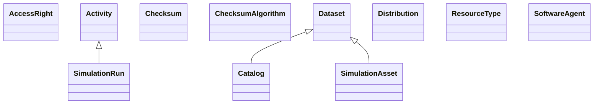

## simulation-asset Properties

### Class Diagram

### Class Hierarchy

- AccessRight (https://w3id.org/ascs-ev/envited-x/simulation-asset/v1/AccessRight)
- Activity (http://www.w3.org/ns/prov#Activity)
  - SimulationRun (https://w3id.org/ascs-ev/envited-x/simulation-asset/v1/SimulationRun)
- Checksum (http://spdx.org/rdf/terms#Checksum)
- ChecksumAlgorithm (https://w3id.org/ascs-ev/envited-x/simulation-asset/v1/ChecksumAlgorithm)
- Dataset (http://www.w3.org/ns/dcat#Dataset)
  - Catalog (http://www.w3.org/ns/dcat#Catalog)
  - SimulationAsset (https://w3id.org/ascs-ev/envited-x/simulation-asset/v1/SimulationAsset)
- Distribution (http://www.w3.org/ns/dcat#Distribution)
- ResourceType (https://w3id.org/ascs-ev/envited-x/simulation-asset/v1/ResourceType)
- SoftwareAgent (http://www.w3.org/ns/prov#SoftwareAgent)

### Class Definitions

|Class|IRI|Description|Parents|
|---|---|---|---|
|AccessRight|https://w3id.org/ascs-ev/envited-x/simulation-asset/v1/AccessRight|Access rights from the EU access-right authority table.||
|Activity|http://www.w3.org/ns/prov#Activity|Something that occurs over a period of time and acts upon or with entities (W3C PROV-O), e.g. a build, a conversion or a simulation run.||
|Catalog|http://www.w3.org/ns/dcat#Catalog|A curated collection of dataset descriptions (W3C DCAT 3), e.g. every simulation asset of one source-repository revision. As in DCAT 3, a catalog is itself a dataset.|Dataset|
|Checksum|http://spdx.org/rdf/terms#Checksum|The result of applying a hash algorithm to a file (SPDX 2.3), as DCAT 3 recommends for distributions.||
|ChecksumAlgorithm|https://w3id.org/ascs-ev/envited-x/simulation-asset/v1/ChecksumAlgorithm|Hash algorithms, as SPDX 2.3 checksum-algorithm individuals.||
|Dataset|http://www.w3.org/ns/dcat#Dataset|A collection of data published or curated by a single agent (W3C DCAT 3). Every resource a simulation needs or produces is one: a scenario, a road network, a 3D model, an OSI trace.||
|Distribution|http://www.w3.org/ns/dcat#Distribution|A specific representation of a dataset (W3C DCAT 3), typically a file, identified by its checksum and reachable through an access or download URL.||
|ResourceType|https://w3id.org/ascs-ev/envited-x/simulation-asset/v1/ResourceType|The role a dataset plays in a simulation.||
|SimulationAsset|https://w3id.org/ascs-ev/envited-x/simulation-asset/v1/SimulationAsset|A self-contained set of data that lets a simulator execute one simulation: a scenario together with the datasets it needs (road network, 3D models, simulator resources), listed as its parts. It is the unit a build system or data platform manages internally and the unit a marketplace offers externally. Its content is described by reference (about), not by subclassing.|Dataset|
|SimulationRun|https://w3id.org/ascs-ev/envited-x/simulation-asset/v1/SimulationRun|One execution of a simulator. It used a simulation asset (and possibly further configuration datasets) and was carried out by a simulator; the results it produced point back to it with prov:wasGeneratedBy.|Activity|
|SoftwareAgent|http://www.w3.org/ns/prov#SoftwareAgent|Running software that bears responsibility for an activity (W3C PROV-O), e.g. a simulator or a converter in a given version.||

## Prefixes

- access-right: <http://publications.europa.eu/resource/authority/access-right/>
- dcat: <http://www.w3.org/ns/dcat#>
- dcterms: <http://purl.org/dc/terms/>
- foaf: <http://xmlns.com/foaf/0.1/>
- prov: <http://www.w3.org/ns/prov#>
- rdf: <http://www.w3.org/1999/02/22-rdf-syntax-ns#>
- rdfs: <http://www.w3.org/2000/01/rdf-schema#>
- schema: <https://schema.org/>
- sh: <http://www.w3.org/ns/shacl#>
- simulation-asset: <https://w3id.org/ascs-ev/envited-x/simulation-asset/v1/>
- spdx: <http://spdx.org/rdf/terms#>
- xsd: <http://www.w3.org/2001/XMLSchema#>

### SHACL Properties

#### dcat:accessURL {: #prop-http---www-w3-org-ns-dcat-accessurl .property-anchor }
#### dcat:byteSize {: #prop-http---www-w3-org-ns-dcat-bytesize .property-anchor }
#### dcat:dataset {: #prop-http---www-w3-org-ns-dcat-dataset .property-anchor }
#### dcat:distribution {: #prop-http---www-w3-org-ns-dcat-distribution .property-anchor }
#### dcat:downloadURL {: #prop-http---www-w3-org-ns-dcat-downloadurl .property-anchor }
#### dcat:keyword {: #prop-http---www-w3-org-ns-dcat-keyword .property-anchor }
#### dcat:mediaType {: #prop-http---www-w3-org-ns-dcat-mediatype .property-anchor }
#### dcat:version {: #prop-http---www-w3-org-ns-dcat-version .property-anchor }
#### dcterms:accessRights {: #prop-http---purl-org-dc-terms-accessrights .property-anchor }
#### dcterms:conformsTo {: #prop-http---purl-org-dc-terms-conformsto .property-anchor }
#### dcterms:created {: #prop-http---purl-org-dc-terms-created .property-anchor }
#### dcterms:description {: #prop-http---purl-org-dc-terms-description .property-anchor }
#### dcterms:hasPart {: #prop-http---purl-org-dc-terms-haspart .property-anchor }
#### dcterms:identifier {: #prop-http---purl-org-dc-terms-identifier .property-anchor }
#### dcterms:issued {: #prop-http---purl-org-dc-terms-issued .property-anchor }
#### dcterms:isVersionOf {: #prop-http---purl-org-dc-terms-isversionof .property-anchor }
#### dcterms:license {: #prop-http---purl-org-dc-terms-license .property-anchor }
#### dcterms:requires {: #prop-http---purl-org-dc-terms-requires .property-anchor }
#### dcterms:title {: #prop-http---purl-org-dc-terms-title .property-anchor }
#### dcterms:type {: #prop-http---purl-org-dc-terms-type .property-anchor }
#### foaf:name {: #prop-http---xmlns-com-foaf-0-1-name .property-anchor }
#### prov:endedAtTime {: #prop-http---www-w3-org-ns-prov-endedattime .property-anchor }
#### prov:startedAtTime {: #prop-http---www-w3-org-ns-prov-startedattime .property-anchor }
#### prov:used {: #prop-http---www-w3-org-ns-prov-used .property-anchor }
#### prov:wasAssociatedWith {: #prop-http---www-w3-org-ns-prov-wasassociatedwith .property-anchor }
#### prov:wasDerivedFrom {: #prop-http---www-w3-org-ns-prov-wasderivedfrom .property-anchor }
#### prov:wasGeneratedBy {: #prop-http---www-w3-org-ns-prov-wasgeneratedby .property-anchor }
#### schema:about {: #prop-https---schema-org-about .property-anchor }
#### schema:softwareVersion {: #prop-https---schema-org-softwareversion .property-anchor }
#### spdx:algorithm {: #prop-http---spdx-org-rdf-terms-algorithm .property-anchor }
#### spdx:checksum {: #prop-http---spdx-org-rdf-terms-checksum .property-anchor }
#### spdx:checksumValue {: #prop-http---spdx-org-rdf-terms-checksumvalue .property-anchor }

|Shape|Property prefix|Property|MinCount|MaxCount|Description|Datatype/NodeKind|Filename|
|---|---|---|---|---|---|---|---|
|ChecksumShape|spdx|checksumValue|1|1|The checksum value, in lower-case hexadecimal as SPDX 2.3 requires.|<http://www.w3.org/2001/XMLSchema#hexBinary>|simulation-asset.shacl.ttl|
|ChecksumShape|spdx|algorithm|1|1|The hash algorithm used to compute the checksum.||simulation-asset.shacl.ttl|
|CatalogShape|dcterms|requires|||A separately published dataset the described one needs but does not include, e.g. a road network offered as an asset of its own.|<http://www.w3.org/ns/shacl#BlankNodeOrIRI>|simulation-asset.shacl.ttl|
|CatalogShape|dcterms|identifier|1|1|Identifier of the resource in the system that manages it, e.g. a build target label. Stable across versions.|<http://www.w3.org/2001/XMLSchema#string>|simulation-asset.shacl.ttl|
|CatalogShape|dcterms|license||1|A legal document giving permission to use the resource, e.g. an SPDX license IRI.|<http://www.w3.org/ns/shacl#IRI>|simulation-asset.shacl.ttl|
|CatalogShape|dcat|version||1|The version indicator of this edition of the resource, e.g. a content digest or a release number.|<http://www.w3.org/2001/XMLSchema#string>|simulation-asset.shacl.ttl|
|CatalogShape|dcterms|issued||1|Date and time of formal issuance (publication) of the resource.|<http://www.w3.org/2001/XMLSchema#dateTime>|simulation-asset.shacl.ttl|
|CatalogShape|schema|about|||The subject matter of the content: a structured content description, such as a scenario description in a domain ontology or a set of ASAM OpenLABEL tags, referenced by IRI.|<http://www.w3.org/ns/shacl#IRI>|simulation-asset.shacl.ttl|
|CatalogShape|dcterms|title|1|1|A name given to the resource.|<http://www.w3.org/2001/XMLSchema#string>|simulation-asset.shacl.ttl|
|CatalogShape|dcat|keyword|||A keyword or tag describing the resource.|<http://www.w3.org/2001/XMLSchema#string>|simulation-asset.shacl.ttl|
|CatalogShape|dcterms|description||1|A free-text account of the resource.|<http://www.w3.org/2001/XMLSchema#string>|simulation-asset.shacl.ttl|
|CatalogShape|dcterms|isVersionOf||1|The resource of which this one is a version: links a content-addressed edition to the stable, version-independent identity of the resource. DCAT 3's inverse dcat:isVersionOf may only be stated in addition to dcat:hasVersion on the logical resource, never in its place (DCAT 3 section 7); the DCMI property carries the back link on its own.|<http://www.w3.org/ns/shacl#IRI>|simulation-asset.shacl.ttl|
|CatalogShape|dcterms|accessRights||1|Who may access the resource, from the EU access-right authority table (public, restricted, non-public) that DCAT-AP uses.||simulation-asset.shacl.ttl|
|CatalogShape|dcterms|hasPart|||A dataset included in the described one, e.g. the scenario, road network and 3D models that make up a simulation asset.|<http://www.w3.org/ns/shacl#BlankNodeOrIRI>|simulation-asset.shacl.ttl|
|CatalogShape|prov|wasDerivedFrom|||A dataset this one was derived from by transformation or modification, e.g. the base scenario of a weather variant.|<http://www.w3.org/ns/shacl#BlankNodeOrIRI>|simulation-asset.shacl.ttl|
|CatalogShape|dcterms|created||1|Date and time of creation of the resource as stated by its author.|<http://www.w3.org/2001/XMLSchema#dateTime>|simulation-asset.shacl.ttl|
|CatalogShape|dcat|dataset|||A dataset listed in the catalog.|<http://www.w3.org/ns/shacl#BlankNodeOrIRI>|simulation-asset.shacl.ttl|
|CatalogShape|dcat|distribution|||An available representation of the dataset, e.g. its file or a packaged archive.|<http://www.w3.org/ns/shacl#BlankNodeOrIRI>|simulation-asset.shacl.ttl|
|CatalogShape|prov|wasGeneratedBy||1|The activity that produced the dataset, e.g. a simulation run.|<http://www.w3.org/ns/shacl#BlankNodeOrIRI>|simulation-asset.shacl.ttl|
|CatalogShape|dcterms|type||1|The role the dataset plays in a simulation.||simulation-asset.shacl.ttl|
|DatasetShape|prov|wasDerivedFrom|||A dataset this one was derived from by transformation or modification, e.g. the base scenario of a weather variant.|<http://www.w3.org/ns/shacl#BlankNodeOrIRI>|simulation-asset.shacl.ttl|
|DatasetShape|dcterms|license||1|A legal document giving permission to use the resource, e.g. an SPDX license IRI.|<http://www.w3.org/ns/shacl#IRI>|simulation-asset.shacl.ttl|
|DatasetShape|dcat|version||1|The version indicator of this edition of the resource, e.g. a content digest or a release number.|<http://www.w3.org/2001/XMLSchema#string>|simulation-asset.shacl.ttl|
|DatasetShape|prov|wasGeneratedBy||1|The activity that produced the dataset, e.g. a simulation run.|<http://www.w3.org/ns/shacl#BlankNodeOrIRI>|simulation-asset.shacl.ttl|
|DatasetShape|dcterms|type||1|The role the dataset plays in a simulation.||simulation-asset.shacl.ttl|
|DatasetShape|dcterms|accessRights||1|Who may access the resource, from the EU access-right authority table (public, restricted, non-public) that DCAT-AP uses.||simulation-asset.shacl.ttl|
|DatasetShape|dcat|distribution|||An available representation of the dataset, e.g. its file or a packaged archive.|<http://www.w3.org/ns/shacl#BlankNodeOrIRI>|simulation-asset.shacl.ttl|
|DatasetShape|dcterms|requires|||A separately published dataset the described one needs but does not include, e.g. a road network offered as an asset of its own.|<http://www.w3.org/ns/shacl#BlankNodeOrIRI>|simulation-asset.shacl.ttl|
|DatasetShape|dcterms|description||1|A free-text account of the resource.|<http://www.w3.org/2001/XMLSchema#string>|simulation-asset.shacl.ttl|
|DatasetShape|dcterms|title||1|A name given to the resource.|<http://www.w3.org/2001/XMLSchema#string>|simulation-asset.shacl.ttl|
|DatasetShape|dcterms|hasPart|||A dataset included in the described one, e.g. the scenario, road network and 3D models that make up a simulation asset.|<http://www.w3.org/ns/shacl#BlankNodeOrIRI>|simulation-asset.shacl.ttl|
|DatasetShape|dcterms|created||1|Date and time of creation of the resource as stated by its author.|<http://www.w3.org/2001/XMLSchema#dateTime>|simulation-asset.shacl.ttl|
|DatasetShape|dcterms|identifier|1|1|Identifier of the resource in the system that manages it, e.g. a build target label. Stable across versions.|<http://www.w3.org/2001/XMLSchema#string>|simulation-asset.shacl.ttl|
|DatasetShape|dcterms|isVersionOf||1|The resource of which this one is a version: links a content-addressed edition to the stable, version-independent identity of the resource. DCAT 3's inverse dcat:isVersionOf may only be stated in addition to dcat:hasVersion on the logical resource, never in its place (DCAT 3 section 7); the DCMI property carries the back link on its own.|<http://www.w3.org/ns/shacl#IRI>|simulation-asset.shacl.ttl|
|DatasetShape|schema|about|||The subject matter of the content: a structured content description, such as a scenario description in a domain ontology or a set of ASAM OpenLABEL tags, referenced by IRI.|<http://www.w3.org/ns/shacl#IRI>|simulation-asset.shacl.ttl|
|DatasetShape|dcat|keyword|||A keyword or tag describing the resource.|<http://www.w3.org/2001/XMLSchema#string>|simulation-asset.shacl.ttl|
|DistributionShape|dcat|accessURL||1|A URL of a resource that gives access to the file, e.g. a repository browser page.|<http://www.w3.org/ns/shacl#IRI>|simulation-asset.shacl.ttl|
|DistributionShape|dcat|byteSize||1|The size of the file in bytes.|<http://www.w3.org/2001/XMLSchema#integer>|simulation-asset.shacl.ttl|
|DistributionShape|dcterms|title||1|A name given to the resource.|<http://www.w3.org/2001/XMLSchema#string>|simulation-asset.shacl.ttl|
|DistributionShape|dcat|mediaType||1|The media type of the file, as an IANA media-type IRI (https://www.iana.org/assignments/media-types/<type>/<subtype>).|<http://www.w3.org/ns/shacl#IRI>|simulation-asset.shacl.ttl|
|DistributionShape|dcterms|conformsTo|||An established standard the file conforms to, e.g. ASAM OpenSCENARIO XML.|<http://www.w3.org/ns/shacl#IRI>|simulation-asset.shacl.ttl|
|DistributionShape|spdx|checksum|1||A checksum of the file.|<http://www.w3.org/ns/shacl#BlankNodeOrIRI>|simulation-asset.shacl.ttl|
|DistributionShape|dcat|downloadURL||1|The URL of the downloadable file.|<http://www.w3.org/ns/shacl#IRI>|simulation-asset.shacl.ttl|
|ActivityShape|prov|wasAssociatedWith|||The software that carried out the activity.|<http://www.w3.org/ns/shacl#BlankNodeOrIRI>|simulation-asset.shacl.ttl|
|ActivityShape|dcterms|identifier||1|Identifier of the resource in the system that manages it, e.g. a build target label. Stable across versions.|<http://www.w3.org/2001/XMLSchema#string>|simulation-asset.shacl.ttl|
|ActivityShape|prov|startedAtTime||1|When the activity started.|<http://www.w3.org/2001/XMLSchema#dateTime>|simulation-asset.shacl.ttl|
|ActivityShape|dcterms|title||1|A name given to the resource.|<http://www.w3.org/2001/XMLSchema#string>|simulation-asset.shacl.ttl|
|ActivityShape|prov|used|||A dataset the activity used, e.g. the simulation asset a run executed.|<http://www.w3.org/ns/shacl#BlankNodeOrIRI>|simulation-asset.shacl.ttl|
|ActivityShape|prov|endedAtTime||1|When the activity ended.|<http://www.w3.org/2001/XMLSchema#dateTime>|simulation-asset.shacl.ttl|
|SoftwareAgentShape|schema|softwareVersion||1|The version of the software.|<http://www.w3.org/2001/XMLSchema#string>|simulation-asset.shacl.ttl|
|SoftwareAgentShape|foaf|name|1|1|The name of the agent.|<http://www.w3.org/2001/XMLSchema#string>|simulation-asset.shacl.ttl|
|SimulationAssetShape|schema|about|||The subject matter of the content: a structured content description, such as a scenario description in a domain ontology or a set of ASAM OpenLABEL tags, referenced by IRI.|<http://www.w3.org/ns/shacl#IRI>|simulation-asset.shacl.ttl|
|SimulationAssetShape|dcat|version||1|The version indicator of this edition of the resource, e.g. a content digest or a release number.|<http://www.w3.org/2001/XMLSchema#string>|simulation-asset.shacl.ttl|
|SimulationAssetShape|dcterms|isVersionOf||1|The resource of which this one is a version: links a content-addressed edition to the stable, version-independent identity of the resource. DCAT 3's inverse dcat:isVersionOf may only be stated in addition to dcat:hasVersion on the logical resource, never in its place (DCAT 3 section 7); the DCMI property carries the back link on its own.|<http://www.w3.org/ns/shacl#IRI>|simulation-asset.shacl.ttl|
|SimulationAssetShape|dcat|distribution|||An available representation of the dataset, e.g. its file or a packaged archive.|<http://www.w3.org/ns/shacl#BlankNodeOrIRI>|simulation-asset.shacl.ttl|
|SimulationAssetShape|prov|wasGeneratedBy||1|The activity that produced the dataset, e.g. a simulation run.|<http://www.w3.org/ns/shacl#BlankNodeOrIRI>|simulation-asset.shacl.ttl|
|SimulationAssetShape|dcterms|hasPart|1||A dataset included in the described one, e.g. the scenario, road network and 3D models that make up a simulation asset.|<http://www.w3.org/ns/shacl#BlankNodeOrIRI>|simulation-asset.shacl.ttl|
|SimulationAssetShape|dcterms|requires|||A separately published dataset the described one needs but does not include, e.g. a road network offered as an asset of its own.|<http://www.w3.org/ns/shacl#BlankNodeOrIRI>|simulation-asset.shacl.ttl|
|SimulationAssetShape|prov|wasDerivedFrom|||A dataset this one was derived from by transformation or modification, e.g. the base scenario of a weather variant.|<http://www.w3.org/ns/shacl#BlankNodeOrIRI>|simulation-asset.shacl.ttl|
|SimulationAssetShape|dcterms|description||1|A free-text account of the resource.|<http://www.w3.org/2001/XMLSchema#string>|simulation-asset.shacl.ttl|
|SimulationAssetShape|dcterms|accessRights||1|Who may access the resource, from the EU access-right authority table (public, restricted, non-public) that DCAT-AP uses.||simulation-asset.shacl.ttl|
|SimulationAssetShape|dcterms|created||1|Date and time of creation of the resource as stated by its author.|<http://www.w3.org/2001/XMLSchema#dateTime>|simulation-asset.shacl.ttl|
|SimulationAssetShape|dcterms|type||1|The role the dataset plays in a simulation.||simulation-asset.shacl.ttl|
|SimulationAssetShape|dcat|keyword|||A keyword or tag describing the resource.|<http://www.w3.org/2001/XMLSchema#string>|simulation-asset.shacl.ttl|
|SimulationAssetShape|dcterms|identifier|1|1|Identifier of the resource in the system that manages it, e.g. a build target label. Stable across versions.|<http://www.w3.org/2001/XMLSchema#string>|simulation-asset.shacl.ttl|
|SimulationAssetShape|dcterms|title|1|1|A name given to the resource.|<http://www.w3.org/2001/XMLSchema#string>|simulation-asset.shacl.ttl|
|SimulationAssetShape|dcterms|license||1|A legal document giving permission to use the resource, e.g. an SPDX license IRI.|<http://www.w3.org/ns/shacl#IRI>|simulation-asset.shacl.ttl|
|SimulationRunShape|prov|startedAtTime||1|When the activity started.|<http://www.w3.org/2001/XMLSchema#dateTime>|simulation-asset.shacl.ttl|
|SimulationRunShape|dcterms|identifier||1|Identifier of the resource in the system that manages it, e.g. a build target label. Stable across versions.|<http://www.w3.org/2001/XMLSchema#string>|simulation-asset.shacl.ttl|
|SimulationRunShape|prov|wasAssociatedWith|1||The software that carried out the activity.|<http://www.w3.org/ns/shacl#BlankNodeOrIRI>|simulation-asset.shacl.ttl|
|SimulationRunShape|prov|used|1||A dataset the activity used, e.g. the simulation asset a run executed.|<http://www.w3.org/ns/shacl#BlankNodeOrIRI>|simulation-asset.shacl.ttl|
|SimulationRunShape|prov|endedAtTime||1|When the activity ended.|<http://www.w3.org/2001/XMLSchema#dateTime>|simulation-asset.shacl.ttl|
|SimulationRunShape|dcterms|title||1|A name given to the resource.|<http://www.w3.org/2001/XMLSchema#string>|simulation-asset.shacl.ttl|
