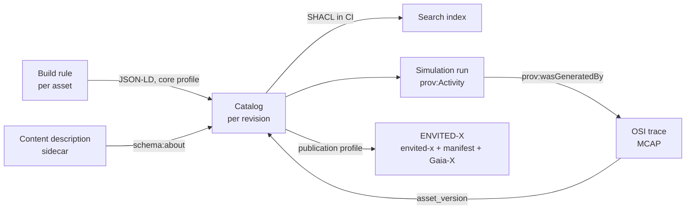

# Simulation asset core

`simulation-asset` (v1) describes simulation assets — scenarios, road
networks, 3D models, simulator resources and simulation results — and their
lineage, with **W3C and community standard terms only**. It is meant for two
consumers at once:

1. **internal tool chains** (build systems, simulation pipelines, search), which
   describe every asset they build, published or not, and
2. **data spaces** such as ENVITED-X, which publish a subset of those assets
   and add their own marketplace terms on top.

The same description serves both: an asset is described once, inside the
organisation that owns it, and a publication profile adds what a marketplace
needs without changing that description.

## Why a core

`manifest` and `envited-x` were written for the data space. They require a
Gaia-X resource description, marketplace access roles (`isOwner`,
`isRegistered`), a licence link and a manifest link, and a simulation manifest
needs at least one artifact each of simulation data, documentation, metadata
and media. Data inside a company cannot satisfy them without inventing values,
and their terms mean nothing to an engineer who runs a simulation.

Most of what they state also exists already as a W3C standard. The core
re-uses those standards instead:

| manifest v6 / envited-x v4 | Standard term in the core | Note |
|---|---|---|
| `envited-x:SimulationAsset` | `dcat:Dataset`, specialised as `simulation-asset:SimulationAsset` | |
| `manifest:hasArtifacts` | `dcterms:hasPart` | the files an asset bundles are its parts (see below) |
| `manifest:hasReferencedArtifacts` | `dcterms:requires` | needed, but published on its own |
| `manifest:Link` / `manifest:FileMetadata` | `dcat:Distribution` | one file of a dataset |
| `manifest:filePath`, `manifest:iri` | `dcat:downloadURL`, `dcat:accessURL` | |
| `manifest:mimeType` (string with pattern) | `dcat:mediaType` | IANA media type IRI |
| `manifest:fileSize` | `dcat:byteSize` | |
| — | `spdx:checksum` (SPDX 2.3 `Checksum`) | as DCAT 3 recommends; manifest has none |
| `manifest:cid` | — | a data-space identifier, see [Identity](#identity) |
| `sh:conformsTo` | `dcterms:conformsTo` | the format standard, e.g. ASAM OpenSCENARIO XML |
| `manifest:hasLicense` / `LicenseLink` | `dcterms:license` | an SPDX licence IRI |
| `manifest:hasAccessRole` (`isPublic`, `isRegistered`, `isOwner`) | `dcterms:accessRights` | EU access-right authority table: `PUBLIC`, `RESTRICTED`, `NON_PUBLIC` |
| `manifest:hasCategory` (`isSimulationData`, …) | `dcterms:type` | a `ResourceType` concept: the role a dataset plays in a simulation |
| `envited-x:hasDomainSpecification` | `schema:about` | a link to the content description |
| — | `prov:wasDerivedFrom`, `prov:wasGeneratedBy`, `prov:used`, `prov:wasAssociatedWith` | lineage; manifest has none |
| `envited-x:hasResourceDescription` (Gaia-X) | — | added by the publication profile only |

## What the core contains

The profile mints two specialisations, six SKOS concepts and three
enumerations; every property and every other class *is* the standard term
(`class_uri` / `slot_uri`):

| Class | IRI | Adds |
|---|---|---|
| Dataset | `dcat:Dataset` | `dcterms:identifier` required |
| SimulationAsset | `simulation-asset:SimulationAsset` ⊑ `dcat:Dataset` | `dcterms:title` and at least one `dcterms:hasPart` required |
| Distribution | `dcat:Distribution` | at least one `spdx:checksum` required |
| Checksum | `spdx:Checksum` | algorithm SHA-256, SHA-384 or SHA-512; value as `xsd:hexBinary` |
| Catalog | `dcat:Catalog` ⊑ `dcat:Dataset` | `dcterms:title` required |
| Activity | `prov:Activity` | |
| SimulationRun | `simulation-asset:SimulationRun` ⊑ `prov:Activity` | `prov:used` and `prov:wasAssociatedWith` a `prov:SoftwareAgent` required |
| SoftwareAgent | `prov:SoftwareAgent` | `foaf:name` required, `schema:softwareVersion` |

The six `skos:Concept`s are the values of `dcterms:type`:
`scenarioDescription`, `roadNetwork`, `objectModel`, `sceneryModel`,
`simulatorResource` and `simulationTrace`. Access rights and checksum
algorithms are not minted: they are the individuals of the EU access-right
table and of SPDX. The enumerations `ResourceType`, `AccessRight` and
`ChecksumAlgorithm` close these value sets (M12): each is an `owl:oneOf` class
of the profile and an `sh:in` list in the shapes.

### Parts, not distributions

In DCAT, the distributions of a dataset are *alternative representations of
the same data*, such as a CSV and a JSON export. The files a simulation needs
together (scenario, road network, object models, scenery, simulator lookup
tables) are not alternatives. Each one is a dataset of its own, typed by its
role (`dcterms:type`), with its own distribution and checksum. The asset lists
them with `dcterms:hasPart`. This also lets two assets share a part: a road
network used by ten scenarios is one dataset, with one checksum.

- `dcterms:requires` names a dataset the asset needs but does not include, for
  example a map that is published separately.
- `prov:wasDerivedFrom` names the asset a variant was made from, for example
  the fog, night and rain variants of one pedestrian-crossing scenario.
- `schema:about` names the **content description**: what happens in the
  scenario (road type, weather, traffic participants, manoeuvres). Inside a
  company this is an individual of a scenario ontology; in ENVITED-X it is
  OpenLABEL tagging (`openlabel-tagging`). The core does not prescribe the
  content vocabulary, so it can evolve without touching the asset
  descriptions.

## Identity

An asset has a **logical** identity, stable across changes, and a **version**
identity, which changes whenever any byte of any part changes.

| | IRI | Example |
|---|---|---|
| logical asset | `tag:` URI (RFC 4151) built from the build label | `tag:example.org,2026:sim//scenarios:cut_in` |
| asset version | logical IRI + `@sha256:` + 16 hex characters | `…//scenarios:cut_in@sha256:a23df4a012f9fe7b` |
| part version | as the asset version, from the file's SHA-256 | `…//maps:two_lane_highway@sha256:063b546122731ef1` |
| file | RFC 6920 `ni:` URI of the file's SHA-256 | `ni:///sha-256;BjtUYSJz…` |

- The asset version digest is the SHA-256 of a canonical JSON object holding
  the asset label and the sorted `[identifier, version]` pairs of its parts.
- `dcterms:identifier` holds the label, `dcat:version` the `sha256:` digest,
  and `dcterms:isVersionOf` links the version to the logical IRI. DCAT 3
  names `dcat:isVersionOf` as the inverse of `dcat:hasVersion`, but an
  inverse "MUST NOT be used to replace" the property it inverts (DCAT 3
  §7), and a version alone cannot state `dcat:hasVersion` on the logical
  asset. A catalogue that describes the logical asset may add
  `dcat:hasVersion` there.
- Naming files by content (`ni:`) makes identical files one node across
  assets. The SPDX checksum states the same digest in the form DCAT
  consumers read.
- **Why not CIDs.** An IPFS CID depends on how the file was chunked. It equals
  the file's SHA-256 only for a file stored as a single raw block (at most
  256 KiB with the default chunker). A CID is therefore computed when the file
  is uploaded to the data space and belongs to the publication profile.
- **Why not `urn:bazel:…`.** There is no such registered URN namespace. A
  build label is unique only inside its repository, and it does not change
  when the file content changes.
- The authority of the `tag:` URI is a domain the organisation controls; the
  tests use `example.org`. Instance data names no persons: authors and e-mail
  addresses found in source files are not copied.

## Life cycle: internal first, then publication

1. **Describe.** The build rule that assembles an asset also writes its
   description, so the checksums are those of the files the simulation
   actually loads. The content description is written next to the scenario
   (a sidecar file) and linked with `schema:about`.
2. **Validate.** CI validates the asset descriptions against the
   `simulation-asset` SHACL shapes and the content description against its
   own ontology.
3. **Catalog and search.** One `dcat:Catalog` per source revision lists every
   asset. A search application loads the catalog together with the content
   descriptions. `SimulationAsset` is the asset class, and the open IRI
   reference `schema:about` joins an asset to its content description.
4. **Simulate.** A `SimulationRun` (a `prov:Activity`) `prov:used` one asset
   *version* and `prov:wasAssociatedWith` the simulator, a `prov:SoftwareAgent`
   with its version. The resulting trace is a `dcat:Dataset` of type
   `simulationTrace`, `prov:wasGeneratedBy` the run and
   `prov:wasDerivedFrom` the asset version.
5. **Trace file.** An OSI trace in MCAP (ASAM OSI trace file formats) gets a
   metadata record `de.asc-s.simulation-asset` next to `net.asam.osi.trace`,
   named in reverse-domain notation as the specification recommends. It holds
   the IRIs `asset`, `asset_version` and `run`. The trace's own IRI cannot be
   among them, because it is derived from the file's SHA-256; the run's PROV
   record states it and names the file by its `ni:` URI. The recommended
   `data_sources` entry of `net.asam.osi.trace` names the asset for people,
   as label and version (`//scenarios:cut_in@sha256:a23df4a012f9fe7b`): it is
   a comma-separated list, and a `tag:` URI contains a comma. Lichtblick hands
   MCAP metadata records to panel extensions
   (`PanelExtensionContext.metadata`), so a panel can show the asset and open
   it in the catalog or search application: the trace leads back to the exact
   files.
6. **Publish.** A publication profile maps a selected asset to ENVITED-X:
   the `envited-x:SimulationAsset` with its manifest, licence link, Gaia-X
   resource description and OpenLABEL tags. Files are uploaded and get their
   CIDs at this step. `PUBLIC`, `RESTRICTED` and `NON_PUBLIC` map to the
   marketplace roles `isPublic`, `isRegistered` and `isOwner`.

### Towards envited-x vNext

In the target architecture, envited-x imports this core instead of restating
it. Its simulation asset becomes a specialisation
(`envited-x:SimulationAsset ⊑ simulation-asset:SimulationAsset`), its links
become `dcat:Distribution`s with SPDX checksums, and only data-space terms
(Gaia-X, access roles, CIDs, the licence and manifest links) remain in the
envited-x namespace. Both schemas name a class `SimulationAsset`, so the
envited-x LinkML class is renamed and keeps its `class_uri` (M4).

## Known limits

- **G17.** The generated OWL describes the standard terms it uses: it gives
  them its own `rdfs:label`, `rdfs:comment` and `skos:inScheme`, states the
  profile's cardinalities and value restrictions as axioms of the standard
  classes (`dcat:Catalog`, `dcat:Dataset`, `dcat:Distribution`,
  `prov:Activity`, `prov:SoftwareAgent`, `spdx:Checksum`) and its datatypes
  as global ranges of `dcterms:created`, `dcterms:issued` and `dcat:byteSize`,
  and links each of these classes with `skos:exactMatch` to an IRI in the
  profile's namespace that nothing declares (`simulation-asset:Dataset`, …).
  It also labels the EU access-right and SPDX checksum-algorithm individuals
  with the enumeration's value names.
  The SHACL shapes are the normative contract. Do not combine the OWL with
  other DCAT profiles for OWL reasoning. `--skip-vacuous-*` keeps the vacuous
  axioms out.
- **G26.** The header annotates the ontology with `dcterms:title`,
  `dcterms:license`, `dcterms:conformsTo` and `dcterms:identifier`, as every
  generated domain does, and the profile uses the same four terms for data.
  In OWL 2 DL no IRI is declared as more than one kind of property, and an
  ontology annotation needs an annotation property, so the profile declares
  the four annotation properties: the OWL states no cardinality for them, the
  SHACL shapes do. The header names its release with `dcterms:source`, so
  `prov:wasDerivedFrom` is only the lineage of the data.
- **G23.** `spdx:checksumValue` is checked as `xsd:hexBinary`. Its length and
  lower case are not checked, because gen-owl would state a pattern on
  `xsd:string` and leave the range empty.
- **R7.** `dcat:byteSize` is an `xsd:integer` of at least zero, not the
  `xsd:nonNegativeInteger` DCAT 3 recommends. The validation store rewrites
  derived integer types to `xsd:integer`.
- **G25.** The shapes of the DCAT, PROV-O and SPDX classes are named after the
  class (`dcat:DistributionShape`), in namespaces this profile does not own.
  The generator's alternative naming also turns every `sh:class` into
  `sh:node`, which drops the type check on references and reports one
  missing checksum four times, so it is not used. A consumer that loads this
  profile together with another profile of the same class gets the union of
  both profiles' constraints either way, because each shape targets the
  class.
- `sh:class` on references (`dcterms:hasPart`, `prov:used`, …) needs the
  referenced nodes typed in the same data graph. A catalog is therefore
  validated as a whole, with every part it references.
- **Namespace.** Like every domain in this repository, the core is published
  under `https://w3id.org/ascs-ev/envited-x/`. The terms a reader meets are
  the standard ones (`dcat:`, `dcterms:`, `prov:`, `spdx:`); only the two
  minted classes and the `ResourceType` concepts carry the `envited-x` path
  segment. Giving data-space-neutral profiles a neutral base path would need
  a new w3id redirect and a major version, and is left to the maintainers.

## Files

- Schema: `linkml/simulation-asset/simulation-asset.yaml`
- Artifacts: `artifacts/simulation-asset/` (generated by
  `just generate-domain simulation-asset`)
- Imported standards, vendored with their checksums: `imports/dcat/`,
  `imports/spdx/`
- Tests: `tests/data/simulation-asset/valid/` (a catalog with a base asset and
  its weather variant; a simulation run with its OSI trace) and
  `tests/data/simulation-asset/invalid/` (a file without checksum, an asset
  without parts, an MD5 checksum, a run without software agent)
